# Entity relationship diagram (PB-05)

This is the core data model for the web app (`web/`, MySQL 8). PB-05's migrations must match
it: same tables, foreign keys and NOT NULL constraints. Later backlog items can add columns
through their own migrations, and this file is updated when they do.

## Conventions

- **NOT NULL by default.** A column is nullable only where the diagram comment says `nullable`.
- **Money** is `decimal(15,2)` in MVR. Floats are never used for money.
- **Foreign keys are `RESTRICT` on delete.** Users are suspended, never deleted, so money,
  audit and KYC history can't vanish through a cascade.
- **Status columns are MySQL `ENUM`s**, so the database itself rejects an unknown status.
- **CHECK constraints** (enforced by MySQL 8.0.16+) protect the rules that matter most. They are
  listed under the diagram because Mermaid can't draw them.
- **Shariah rule:** only `conventional` campaigns can hold an interest rate. A CHECK constraint
  makes it impossible to store one on a Murabahah or Mudarabah campaign. Each contract's terms
  are required for that contract and NULL for the others (two-way CHECKs).
- **`return_due` is two-way by contract.** Mudarabah instalments leave it NULL (not even 0),
  because the investors' return depends on profit the business reports later (PB-29); a fixed
  figure would be a guaranteed return. Conventional and Murabahah instalments must state it,
  as zero or more. The `RepaymentSchedule` model enforces this (see below).
- **A Mudarabah schedule is planned capital returns, not a debt (PB-34).** Its rows share the
  table with conventional and Murabahah instalments, but `due_date` is the planned date and
  `capital_due` the planned capital return: capital is returned according to the business's
  results, and in a genuine business loss investors bear the loss of capital in proportion to
  their share (except negligence or misconduct, PB-29). The columns carry MySQL comments saying
  so, and the app never labels these rows "instalment", "due", "owed" or "late".
- **Repayments and Mudarabah reports (PB-35, PB-36, PB-29).** A conventional or Murabahah
  instalment is paid whole (one `repayments` row per schedule row) and shared out to the
  investors at once; each investor's share is an `investor_payouts` row with capital and return
  apart. A Mudarabah is never repaid: the business submits a `business_reports` row per period,
  and only an approved report moves money. Each investor's Mudarabah capital account is derived
  from `investor_payouts`: outstanding capital = settled pledges − capital − loss, unrestored
  loss = loss − loss restored. There are no late fees or penalty columns anywhere.
- **Personal identifiers are encrypted.** `national_id_no` uses Laravel's `encrypted` cast, so
  the database only ever holds ciphertext. The column is `text` because the encrypted value
  (about 200 characters) is longer than the ID itself, and it can't be indexed or searched.
- Timestamps: every table has `created_at`/`updated_at` unless it is append-only
  (`wallet_transactions`, `audit_logs` have a NOT NULL `created_at` only). Laravel's
  `timestamps()` makes `created_at`/`updated_at` nullable; Eloquent always fills them.
- `web/tests/Feature/Database/SchemaMatchesErdTest.php` compares the migrated schema with this
  file (every column, its nullability, every foreign key and CHECK). Update both together.

## Diagram

```mermaid
erDiagram
    roles ||--o{ users : "assigned to"
    users ||--o| borrower_profiles : "has"
    users ||--o| investor_profiles : "has"
    users ||--o{ kyc_documents : "uploads"
    atolls ||--o{ islands : "contains (PB-53)"
    islands |o--o{ borrower_profiles : "address (PB-53)"
    islands |o--o{ investor_profiles : "address (PB-53)"
    campaigns |o--o| kyc_documents : "credit report (PB-14)"
    campaigns ||--o| campaign_financials : "financial information (PB-14)"
    users |o--o{ kyc_documents : "reviews"
    users ||--o{ campaigns : "raises (borrower)"
    users ||--o{ pledges : "makes (investor)"
    campaigns ||--o{ pledges : "receives"
    users |o--o| wallet_accounts : "owns (user wallet)"
    campaigns |o--o| wallet_accounts : "owns (escrow)"
    wallet_accounts ||--o{ wallet_transactions : "ledger of"
    pledges |o--o{ wallet_transactions : "money for"
    repayments |o--o{ wallet_transactions : "money for"
    campaigns ||--o{ repayment_schedules : "instalments"
    repayment_schedules ||--o| repayments : "paid by (PB-35)"
    campaigns ||--o{ business_reports : "Mudarabah reports (PB-29)"
    repayment_schedules ||--o{ business_reports : "period of"
    users ||--o{ business_reports : "submits, reviews"
    kyc_documents |o--o| business_reports : "supporting document"
    business_reports |o--o{ wallet_transactions : "money for"
    repayments |o--o{ investor_payouts : "shared out (PB-36)"
    business_reports |o--o{ investor_payouts : "shared out (PB-29)"
    pledges ||--o{ investor_payouts : "share of"
    users ||--o{ investor_payouts : "received by (investor)"
    campaigns ||--o{ risk_scores : "scored by"
    users ||--o{ notifications : "receives (polymorphic)"
    users |o--o{ audit_logs : "performs"

    roles {
        bigint id PK
        varchar name UK "borrower | investor | admin"
        varchar label "display name"
    }

    users {
        bigint id PK
        bigint role_id FK
        varchar name
        varchar email UK
        timestamp email_verified_at "nullable"
        varchar password "hashed"
        varchar remember_token "nullable"
        enum status "pending_verification | verified | rejected | suspended"
        varchar status_reason "nullable, why rejected or suspended"
        enum theme "nullable: light | dark; NULL = follow the device (PB-55, PB-57)"
        enum theme_system_at_choice "nullable: the device's light | dark when the choice was made (PB-57)"
        timestamp verification_submitted_at "nullable, set by Submit at the end of onboarding (PB-53)"
    }

    borrower_profiles {
        bigint id PK
        bigint user_id FK, UK
        enum borrower_type "individual | sme"
        varchar phone
        text national_id_no "encrypted cast"
        varchar address_house "nullable until the address step (PB-53)"
        varchar address_road "nullable, the magu"
        bigint island_id FK "nullable, islands.id (implies the atoll)"
        char postcode "nullable, 5 digits (CHECK)"
        varchar business_name "nullable (individuals)"
        varchar business_registration_no "nullable"
        varchar sector "nullable"
        smallint years_operating "nullable"
        decimal monthly_income "nullable until the finance step; before tax (SME: average monthly revenue), PB-58"
        decimal monthly_debt_repayments "nullable, excluding housing"
        tinyint employment_years "nullable, 0-10"
        enum housing "nullable: rent | own | own_with_home_loan | family_home"
        smallint open_credit_lines "nullable, self-declared"
        smallint late_payments_2y "nullable, self-declared"
        smallint public_records "nullable, self-declared"
    }

    investor_profiles {
        bigint id PK
        bigint user_id FK, UK
        varchar phone
        text national_id_no "encrypted cast"
        varchar address_house "nullable until the address step (PB-53)"
        varchar address_road "nullable, the magu"
        bigint island_id FK "nullable, islands.id (implies the atoll)"
        char postcode "nullable, 5 digits (CHECK)"
        timestamp risk_acknowledged_at "nullable, set when accepted"
        boolean shariah_only "default false"
    }

    kyc_documents {
        bigint id PK
        bigint user_id FK "owner"
        bigint campaign_id FK "nullable, set only for a credit_report (PB-14)"
        enum document_type "national_id | business_registration | financial_statement | proof_of_address | other | credit_report | salary_slip"
        varchar original_name
        varchar storage_path "private disk"
        varchar mime_type
        int size_bytes
        enum status "pending | approved | rejected"
        bigint reviewed_by FK "nullable, admin user"
        timestamp reviewed_at "nullable"
        varchar rejection_reason "nullable"
        timestamp replaced_at "nullable, set when a newer upload takes the slot (PB-53)"
        varchar current_slot "generated: document_type while current, else NULL; UK with user_id"
    }

    atolls {
        bigint id PK
        varchar code UK "HA, HDh, ... S; Malé City"
        varchar name UK
        tinyint sort_order "north to south"
    }

    islands {
        bigint id PK
        bigint atoll_id FK
        varchar name "UK with atoll_id"
    }

    campaigns {
        bigint id PK
        bigint borrower_id FK "users.id"
        varchar title
        enum purpose "start_up | growth | education | personal"
        text description
        text business_background "nullable"
        decimal amount_requested "asset cost for Murabahah"
        smallint tenure_months
        enum contract_type "conventional | murabahah | mudarabah"
        decimal interest_rate_percent "nullable, required for conventional, else NULL"
        decimal markup_amount "nullable, required for murabahah, else NULL"
        varchar asset_description "nullable, required for murabahah, else NULL"
        decimal investor_profit_share_percent "nullable, required for mudarabah, else NULL"
        enum status "draft | submitted | live | rejected | suspended | funded | failed | repaying | completed | defaulted"
        varchar status_reason "nullable"
        datetime funding_deadline "nullable, set on approval"
        timestamp submitted_at "nullable"
        timestamp approved_at "nullable"
        timestamp funded_at "nullable"
        timestamp disbursed_at "nullable, paid out to the borrower (PB-34); schedule starts a month later"
    }

    campaign_financials {
        bigint id PK
        bigint campaign_id FK, UK
        decimal monthly_income "snapshot of the profile at submission (PB-58), > 0; the model uses × 12"
        decimal monthly_debt_repayments "excluding housing, >= 0"
        tinyint employment_years "0-10, 10 = ten or more"
        enum housing "rent | own | own_with_home_loan | family_home"
        smallint open_credit_lines "self-declared"
        smallint late_payments_2y "self-declared"
        smallint public_records "self-declared"
    }

    pledges {
        bigint id PK
        bigint campaign_id FK
        bigint investor_id FK "users.id"
        decimal amount
        enum status "held | refunded | settled"
    }

    wallet_accounts {
        bigint id PK
        enum type "user | escrow | external"
        bigint user_id FK, UK "nullable, set when type = user"
        bigint campaign_id FK, UK "nullable, set when type = escrow"
        tinyint singleton UK "1 for the one external account (PB-18), else NULL"
    }

    wallet_transactions {
        bigint id PK
        bigint wallet_account_id FK
        enum wallet_type "the account's type, for the CHECK below (PB-18)"
        char transfer_ref "uuid shared by both legs of one movement"
        enum type "top_up | withdrawal | pledge | pledge_refund | disbursement | repayment | return_payout | mudarabah_payment | mudarabah_payout"
        enum direction "credit | debit"
        decimal amount "always positive"
        decimal balance_after "running balance, never negative except the external account"
        bigint pledge_id FK "nullable, required for return_payout and mudarabah_payout"
        bigint repayment_id FK "nullable, required for repayment and return_payout"
        bigint business_report_id FK "nullable, required for mudarabah_payment and mudarabah_payout (PB-29)"
        varchar description "nullable"
        timestamp created_at
    }

    repayment_schedules {
        bigint id PK
        bigint campaign_id FK
        smallint instalment_no
        date due_date
        decimal capital_due "Mudarabah: planned capital return, not a debt (PB-34)"
        decimal return_due "nullable, NULL for mudarabah, required and >= 0 otherwise (model rule)"
        enum status "due | paid | late"
        timestamp paid_at "nullable"
    }

    repayments {
        bigint id PK
        bigint repayment_schedule_id FK, UK "one per instalment (PB-35)"
        decimal amount "capital_amount + return_amount"
        decimal capital_amount
        decimal return_amount "interest or markup; 0 for a conventional row paid off early"
        enum kind "instalment | early_payoff"
        timestamp paid_at
    }

    business_reports {
        bigint id PK
        bigint campaign_id FK
        bigint repayment_schedule_id FK "the period reported"
        bigint submitted_by FK "the business"
        decimal revenue ">= 0"
        decimal costs ">= 0"
        decimal profit "revenue - costs, negative for a loss"
        decimal capital_returned ">= 0"
        bigint kyc_document_id FK "nullable, supporting document"
        enum status "submitted | approved | rejected"
        bigint open_slot UK "generated: the period while not rejected"
        enum loss_cause "nullable, business | negligence, approved losses only"
        varchar decision_reason "nullable, required to reject or to find negligence"
        decimal loss_restored "nullable until approved"
        decimal investors_profit "nullable until approved"
        decimal business_profit "nullable until approved"
        decimal loss_borne "nullable until approved, genuine loss borne by investors"
        decimal business_liable_loss "nullable until approved, negligence or misconduct"
        timestamp submitted_at
        bigint reviewed_by FK "nullable"
        timestamp reviewed_at "nullable"
    }

    investor_payouts {
        bigint id PK
        bigint campaign_id FK
        bigint investor_id FK
        bigint pledge_id FK "the investor's first settled pledge"
        bigint repayment_id FK "nullable, exactly one source"
        bigint business_report_id FK "nullable, exactly one source"
        decimal capital_amount
        decimal loss_restored_amount "Mudarabah: earlier loss restored from profit"
        decimal return_amount "interest, markup or profit share"
        decimal loss_amount "Mudarabah: genuine loss allocated, no money"
        char transfer_ref "nullable, the payout transfer; NULL for a loss only"
        timestamp created_at
    }

    risk_scores {
        bigint id PK
        bigint campaign_id FK
        enum status "pending | scored | failed"
        json input_features "exact payload sent to the service"
        decimal probability_of_default "nullable until scored"
        enum grade "nullable, A | B | C | D | E"
        json top_factors "nullable, SHAP factors"
        varchar model_version "nullable until scored"
        tinyint attempts "default 0"
        varchar error_message "nullable"
        timestamp scored_at "nullable"
    }

    notifications {
        uuid id PK
        varchar type "notification class"
        varchar notifiable_type "polymorphic, App-Models-User"
        bigint notifiable_id "polymorphic, no FK"
        text data "JSON payload"
        timestamp read_at "nullable"
    }

    audit_logs {
        bigint id PK
        bigint actor_id FK "nullable, null = system job"
        varchar action "e.g. kyc.approved"
        varchar subject_type "nullable, polymorphic"
        bigint subject_id "nullable, polymorphic"
        json details "nullable, reason, before and after"
        varchar ip_address "nullable"
        timestamp created_at
    }
```

## Constraints Mermaid can't show

| Table | Constraint | Why |
|---|---|---|
| campaigns | CHECK `interest_rate_percent` is NOT NULL (and ≥ 0) when `contract_type = 'conventional'`, NULL otherwise | Shariah mode never stores an interest rate; a conventional campaign always states one |
| campaigns | CHECK `markup_amount` (≥ 0) and `asset_description` are NOT NULL when `contract_type = 'murabahah'`, NULL otherwise | A Murabahah needs a disclosed markup and a real asset; other contracts can't carry them |
| campaigns | CHECK `investor_profit_share_percent` is NOT NULL and strictly between 0 and 100 when `contract_type = 'mudarabah'`, NULL otherwise | A profit-sharing ratio both sides receive something from; not a guaranteed return |
| campaigns | CHECK `amount_requested > 0`, `tenure_months > 0` | No zero or negative requests |
| repayments | CHECK `amount = capital_amount + return_amount`, both ≥ 0; UNIQUE `repayment_schedule_id` | A repayment records its split exactly, and an instalment can't be paid twice (PB-35) |
| business_reports | CHECK `revenue`, `costs`, `capital_returned` ≥ 0 and `profit = revenue - costs` | The profit or loss always follows from the figures reported (PB-29) |
| business_reports | CHECK the outcome columns are NULL until approved, and then account for the whole profit (`loss_restored + investors_profit + business_profit = profit`) or the whole loss (genuine: `loss_borne ≤ loss`; negligence: `business_liable_loss = loss`, `loss_borne = 0`) | An approved report can't lose or invent money, and a negligence loss is never charged to investors |
| business_reports | CHECK a loss cause exactly for approved losses; a reason to reject or to find negligence; reviewer and time once decided | The decision is always recorded with who made it and why |
| business_reports | UNIQUE `open_slot` (generated: the period while the report is not rejected) | One open report per period; rejected ones stay on record |
| investor_payouts | CHECK exactly one of `repayment_id`, `business_report_id`; repayment rows carry no loss parts; all parts ≥ 0 and not all zero; `transfer_ref` NULL exactly when no money moved | Every share traces to one source, and only a pure loss allocation has no transfer |
| investor_payouts | UNIQUE (`repayment_id`, `investor_id`), (`business_report_id`, `investor_id`) | One share per investor per source |
| wallet_transactions | CHECK `type <> 'repayment'` or `repayment_id` NOT NULL; `mudarabah_payment` needs `business_report_id`; `mudarabah_payout` needs `pledge_id` and `business_report_id` | Every repayment and Mudarabah movement traces to its source (PB-35, PB-29) |
| pledges, repayments | CHECK `amount > 0` | No zero or negative money movements |
| campaign_financials | CHECK `monthly_income > 0` (was `annual_income`, PB-58), `monthly_debt_repayments >= 0`, `employment_years <= 10`; counts are unsigned; UNIQUE `campaign_id` | One set of financial information per request, with no impossible values (PB-14) |
| kyc_documents | CHECK (`document_type` in (`credit_report`, `business_report`) and `campaign_id` NOT NULL) or (any other type and `campaign_id` NULL) | A credit report or a business report's document always belongs to a campaign; an identity document never does (PB-14, PB-29) |
| wallet_accounts | CHECK exactly one owner: (`type = 'user'`, `user_id` set) or (`type = 'escrow'`, `campaign_id` set) or (`type = 'external'`, no owner, `singleton = 1`) | Every wallet has exactly one owner; the outside world (simulated bank) is one account (PB-18) |
| wallet_accounts | UNIQUE `singleton`; UNIQUE `(id, type)` | Only one external account; the target of the composite foreign key below |
| wallet_transactions | CHECK `amount > 0` and (`wallet_type = 'external'` or `balance_after >= 0`) | The database itself refuses a negative user or escrow balance; only the outside world goes below zero (PB-18) |
| wallet_transactions | FOREIGN KEY `(wallet_account_id, wallet_type)` → `wallet_accounts (id, type)` | An entry can't claim to belong to the external account to dodge the CHECK |
| wallet_transactions | CHECK `type <> 'return_payout'` or both `pledge_id` and `repayment_id` are NOT NULL | Every payout traces to the investor's pledge and the repayment it came from |
| wallet_transactions | INDEX `transfer_ref` | Find both legs of one transfer |
| repayment_schedules | UNIQUE (`campaign_id`, `instalment_no`) | No duplicate instalments |
| repayment_schedules | CHECK `capital_due >= 0` and `return_due` NULL or ≥ 0 | No negative amounts owed |
| risk_scores | CHECK `probability_of_default` between 0 and 1 | It's a probability |
| notifications | INDEX (`notifiable_type`, `notifiable_id`) | Laravel's standard notifications table |

## Rules enforced in the model, not the database

A MySQL CHECK can only look at columns of the row being written, not at another table, so
rules that depend on a related row live in the Eloquent model and are covered by tests.

| Model | Rule | Why |
|---|---|---|
| `Campaign` | Once `funded_at` is stored, the agreed terms (`amount_requested`, `tenure_months`, `contract_type`, `interest_rate_percent`, `markup_amount`, `asset_description`, `investor_profit_share_percent`) can't change; a save that changes one throws `ContractRuleViolation` (PB-28). | A Murabahah's markup is disclosed and fixed when the contract is agreed, so the sale price repaid is always the one investors and the borrower saw. The rule compares with the stored row, which a CHECK can't do. |
| `RepaymentSchedule` | Two-way `return_due` rule, checked on every save (insert and update) through Eloquent; a violation throws `ContractRuleViolation`. **Mudarabah:** `return_due` must be NULL; any value, including 0, is rejected. **Conventional and Murabahah:** `return_due` is required (NULL rejected) and must be zero or more (negative rejected). | A Mudarabah return depends on reported profit (PB-29), so a predetermined figure, even zero, would be a guaranteed return. Conventional and Murabahah instalments always carry an interest or markup share, which can be 0 but never negative. |

Model rules only run when rows are saved through Eloquent. A raw `DB::table()->insert()`, a
bulk `update()` query, or a seeder using the `WithoutModelEvents` trait (as Laravel's default
`DatabaseSeeder` does) skips them, so the code never writes these tables that way. The one
exception is `repayments:mark-late` (PB-35), which bulk-updates only `repayment_schedules.status`
between `due` and `late`; it never touches `return_due`, the column the model rule protects. The
`repayment_schedules_return_due_check` CHECK (`return_due` NULL or ≥ 0) still stops a negative
value even then; only the contract-dependent part needs the model. A MySQL
trigger could enforce the rule in the database instead; it was not used because it hides
logic outside the PHP code that is reviewed and tested.

## Allowed values kept in code (PB-09 to PB-11)

These columns are `varchar` or `text` in the database, and the form requests restrict them to fixed
values listed in the models. They are not ENUMs because the lists may grow without a migration.

| Column | Allowed values | Where |
|---|---|---|
| `borrower_profiles.sector` | `agriculture`, `construction`, `education`, `fisheries`, `food_and_beverage`, `health`, `manufacturing`, `retail`, `technology`, `tourism`, `transport`, `other_services` (NULL for individuals) | `BorrowerProfile::SECTORS` |
| `borrower_profiles.phone`, `investor_profiles.phone` | Stored as `+960 NNNNNNN` | `ValidatesPersonalDetails` |
| `kyc_documents.document_type` | Fixed slots, every one required (PB-53). Individual borrower: `national_id`, `proof_of_address`. SME borrower: `national_id`, `business_registration`, `proof_of_address`, `financial_statement`. Investor: `national_id`, `proof_of_address`. (`other` is never offered.) One current document per slot: `UNIQUE (user_id, current_slot)`. | `DocumentSlots` |
| `borrower_profiles.postcode`, `investor_profiles.postcode` | Exactly 5 digits (`CHECK ... REGEXP '^[0-9]{5}$'`) | `AddressRequest` |
| `islands` | 21 atolls (20 administrative atolls and Malé City) and 188 inhabited islands, loaded by the migration from `database/data/maldives_islands.php` (sources cited there) | `Atoll::options()` |
| `kyc_documents.storage_path` | `{user_id}/{40 random characters}.{pdf,png,jpg}` on the private `kyc` disk; the file is encrypted with APP_KEY | `KycDocumentStore` |

## Financing requests (PB-13 to PB-15)

| Rule | Where |
|---|---|
| Limits: amount MVR 10,000 – 2,000,000; tenure 3, 6, 12, 18, 24, 36, 48 or 60 months; interest rate 0–30% (conventional only); markup 0 up to the asset cost; investors' profit share 1–99% | `Campaign` constants, `StoreCampaignRequest` |
| Status flow: `submitted` (borrower) → `live` (approve) or `rejected` (reject, with reason); `live` → `suspended` (suspend, with reason). `draft` is not used yet | `CampaignReviewService` |
| `funding_deadline` = the end of the 30th day after approval, Maldives time (stored in UTC, e.g. 18:59:59) | `Campaign::FUNDING_DAYS`, `Campaign::fundingDeadlineFrom()` |
| The marketplace lists `live` campaigns whose deadline has not passed | `Campaign::scopeListed()` |
| `User::kycDocuments()` returns identity documents only (`campaign_id` NULL), so account verification never sees or decides a credit report; `Campaign::creditReport()` returns the report | `User`, `Campaign` |
| `campaign_financials.housing`, `employment_years` and the purpose map to the risk model's values (`family_home` → OTHER) | `RiskFeatures` |

## How money moves (for reading the wallet tables)

Every movement is one or two `wallet_transactions` rows, written in one database transaction
and sharing a `transfer_ref`:

| Event | Debit | Credit |
|---|---|---|
| Top-up (simulated) | | investor or borrower wallet |
| Withdrawal (simulated) | user wallet | |
| Pledge | investor wallet | campaign escrow |
| Refund (deadline missed) | campaign escrow | investor wallet |
| Disbursement (funded) | campaign escrow | borrower wallet |
| Repayment (PB-35) | borrower wallet | campaign escrow (`repayment`) |
| Return payout (PB-36), same transaction | campaign escrow | each investor wallet, pro rata (`return_payout`) |
| Mudarabah report approved (PB-29) | business wallet | campaign escrow (`mudarabah_payment`) |
| Mudarabah payout, same transaction | campaign escrow | each investor wallet, pro rata (`mudarabah_payout`) |

A genuine Mudarabah loss moves no money: it is an `investor_payouts` row with only
`loss_amount`. The escrow is back at zero after every repayment and approved report.

A wallet's balance is the `balance_after` of its latest row, and must always equal
credits minus debits. PB-18 tests that this reconciles; `wallet:reconcile` (LedgerReconciler)
also checks rules 8 to 10 for repayments, reports, payouts and Mudarabah capital accounts.
