# Entity relationship diagram (PB-05)

This is the core data model for the web app (`web/`, MySQL 8). PB-05's migrations must match
it: same tables, foreign keys and NOT NULL constraints. Later backlog items can add columns
through their own migrations, and this file is updated when they do.

## Conventions

- **NOT NULL by default.** A column is nullable only where the diagram comment says `nullable`.
- **Money** is `decimal(15,2)` in MVR. Floats are never used for money.
- **Foreign keys are `RESTRICT` on delete.** Users are suspended, never deleted, so money,
  audit and KYC history can't vanish through a cascade.
- **Status columns are MySQL `ENUM`s**, so the database itself rejects an unknown status.
- **CHECK constraints** (enforced by MySQL 8.0.16+) protect the rules that matter most. They are
  listed under the diagram because Mermaid can't draw them.
- **Shariah rule:** only `conventional` campaigns can hold an interest rate. A CHECK constraint
  makes it impossible to store one on a Murabahah or Mudarabah campaign. Each contract's terms
  are required for that contract and NULL for the others (two-way CHECKs).
- **`return_due` is two-way by contract.** Mudarabah instalments leave it NULL (not even 0),
  because the investors' return depends on profit the business reports later (PB-29); a fixed
  figure would be a guaranteed return. Conventional and Murabahah instalments must state it,
  as zero or more. The `RepaymentSchedule` model enforces this (see below).
- **Personal identifiers are encrypted.** `national_id_no` uses Laravel's `encrypted` cast, so
  the database only ever holds ciphertext. The column is `text` because the encrypted value
  (about 200 characters) is longer than the ID itself, and it can't be indexed or searched.
- Timestamps: every table has `created_at`/`updated_at` unless it is append-only
  (`wallet_transactions`, `audit_logs` have a NOT NULL `created_at` only). Laravel's
  `timestamps()` makes `created_at`/`updated_at` nullable; Eloquent always fills them.
- `web/tests/Feature/Database/SchemaMatchesErdTest.php` compares the migrated schema with this
  file (every column, its nullability, every foreign key and CHECK). Update both together.

## Diagram

```mermaid
erDiagram
    roles ||--o{ users : "assigned to"
    users ||--o| borrower_profiles : "has"
    users ||--o| investor_profiles : "has"
    users ||--o{ kyc_documents : "uploads"
    users |o--o{ kyc_documents : "reviews"
    users ||--o{ campaigns : "raises (borrower)"
    users ||--o{ pledges : "makes (investor)"
    campaigns ||--o{ pledges : "receives"
    users |o--o| wallet_accounts : "owns (user wallet)"
    campaigns |o--o| wallet_accounts : "owns (escrow)"
    wallet_accounts ||--o{ wallet_transactions : "ledger of"
    pledges |o--o{ wallet_transactions : "money for"
    repayments |o--o{ wallet_transactions : "money for"
    campaigns ||--o{ repayment_schedules : "instalments"
    repayment_schedules ||--o{ repayments : "paid by"
    campaigns ||--o{ risk_scores : "scored by"
    users ||--o{ notifications : "receives (polymorphic)"
    users |o--o{ audit_logs : "performs"

    roles {
        bigint id PK
        varchar name UK "borrower | investor | admin"
        varchar label "display name"
    }

    users {
        bigint id PK
        bigint role_id FK
        varchar name
        varchar email UK
        timestamp email_verified_at "nullable"
        varchar password "hashed"
        varchar remember_token "nullable"
        enum status "pending_verification | verified | rejected | suspended"
        varchar status_reason "nullable, why rejected or suspended"
    }

    borrower_profiles {
        bigint id PK
        bigint user_id FK, UK
        enum borrower_type "individual | sme"
        varchar phone
        text national_id_no "encrypted cast"
        text address
        varchar business_name "nullable (individuals)"
        varchar business_registration_no "nullable"
        varchar sector "nullable"
        smallint years_operating "nullable"
        decimal declared_annual_income "income or revenue"
    }

    investor_profiles {
        bigint id PK
        bigint user_id FK, UK
        varchar phone
        text national_id_no "encrypted cast"
        text address
        timestamp risk_acknowledged_at "nullable, set when accepted"
        boolean shariah_only "default false"
    }

    kyc_documents {
        bigint id PK
        bigint user_id FK "owner"
        enum document_type "national_id | business_registration | financial_statement | proof_of_address | other"
        varchar original_name
        varchar storage_path "private disk"
        varchar mime_type
        int size_bytes
        enum status "pending | approved | rejected"
        bigint reviewed_by FK "nullable, admin user"
        timestamp reviewed_at "nullable"
        varchar rejection_reason "nullable"
    }

    campaigns {
        bigint id PK
        bigint borrower_id FK "users.id"
        varchar title
        enum purpose "start_up | growth | education | personal"
        text description
        text business_background "nullable"
        decimal amount_requested "asset cost for Murabahah"
        smallint tenure_months
        enum contract_type "conventional | murabahah | mudarabah"
        decimal interest_rate_percent "nullable, required for conventional, else NULL"
        decimal markup_amount "nullable, required for murabahah, else NULL"
        varchar asset_description "nullable, required for murabahah, else NULL"
        decimal investor_profit_share_percent "nullable, required for mudarabah, else NULL"
        enum status "draft | submitted | live | rejected | suspended | funded | failed | repaying | completed | defaulted"
        varchar status_reason "nullable"
        datetime funding_deadline "nullable, set on approval"
        timestamp submitted_at "nullable"
        timestamp approved_at "nullable"
        timestamp funded_at "nullable"
    }

    pledges {
        bigint id PK
        bigint campaign_id FK
        bigint investor_id FK "users.id"
        decimal amount
        enum status "held | refunded | settled"
    }

    wallet_accounts {
        bigint id PK
        enum type "user | escrow"
        bigint user_id FK, UK "nullable, set when type = user"
        bigint campaign_id FK, UK "nullable, set when type = escrow"
    }

    wallet_transactions {
        bigint id PK
        bigint wallet_account_id FK
        char transfer_ref "uuid shared by both legs of one movement"
        enum type "top_up | withdrawal | pledge | pledge_refund | disbursement | repayment | return_payout"
        enum direction "credit | debit"
        decimal amount "always positive"
        decimal balance_after "running balance, never negative"
        bigint pledge_id FK "nullable, required for return_payout"
        bigint repayment_id FK "nullable, required for return_payout"
        varchar description "nullable"
        timestamp created_at
    }

    repayment_schedules {
        bigint id PK
        bigint campaign_id FK
        smallint instalment_no
        date due_date
        decimal capital_due
        decimal return_due "nullable, NULL for mudarabah, required and >= 0 otherwise (model rule)"
        enum status "due | paid | late"
        timestamp paid_at "nullable"
    }

    repayments {
        bigint id PK
        bigint repayment_schedule_id FK
        decimal amount
        timestamp paid_at
    }

    risk_scores {
        bigint id PK
        bigint campaign_id FK
        enum status "pending | scored | failed"
        json input_features "exact payload sent to the service"
        decimal probability_of_default "nullable until scored"
        enum grade "nullable, A | B | C | D | E"
        json top_factors "nullable, SHAP factors"
        varchar model_version "nullable until scored"
        tinyint attempts "default 0"
        varchar error_message "nullable"
        timestamp scored_at "nullable"
    }

    notifications {
        uuid id PK
        varchar type "notification class"
        varchar notifiable_type "polymorphic, App-Models-User"
        bigint notifiable_id "polymorphic, no FK"
        text data "JSON payload"
        timestamp read_at "nullable"
    }

    audit_logs {
        bigint id PK
        bigint actor_id FK "nullable, null = system job"
        varchar action "e.g. kyc.approved"
        varchar subject_type "nullable, polymorphic"
        bigint subject_id "nullable, polymorphic"
        json details "nullable, reason, before and after"
        varchar ip_address "nullable"
        timestamp created_at
    }
```

## Constraints Mermaid can't show

| Table | Constraint | Why |
|---|---|---|
| campaigns | CHECK `interest_rate_percent` is NOT NULL (and ≥ 0) when `contract_type = 'conventional'`, NULL otherwise | Shariah mode never stores an interest rate; a conventional campaign always states one |
| campaigns | CHECK `markup_amount` (≥ 0) and `asset_description` are NOT NULL when `contract_type = 'murabahah'`, NULL otherwise | A Murabahah needs a disclosed markup and a real asset; other contracts can't carry them |
| campaigns | CHECK `investor_profit_share_percent` is NOT NULL and strictly between 0 and 100 when `contract_type = 'mudarabah'`, NULL otherwise | A profit-sharing ratio both sides receive something from; not a guaranteed return |
| campaigns | CHECK `amount_requested > 0`, `tenure_months > 0` | No zero or negative requests |
| pledges, repayments | CHECK `amount > 0` | No zero or negative money movements |
| wallet_accounts | CHECK exactly one owner: (`type = 'user'`, `user_id` set, `campaign_id` NULL) or (`type = 'escrow'`, `campaign_id` set, `user_id` NULL) | Every wallet has exactly one owner |
| wallet_transactions | CHECK `amount > 0` and `balance_after >= 0` | The database itself refuses a negative balance |
| wallet_transactions | CHECK `type <> 'return_payout'` or both `pledge_id` and `repayment_id` are NOT NULL | Every payout traces to the investor's pledge and the repayment it came from |
| wallet_transactions | INDEX `transfer_ref` | Find both legs of one transfer |
| repayment_schedules | UNIQUE (`campaign_id`, `instalment_no`) | No duplicate instalments |
| repayment_schedules | CHECK `capital_due >= 0` and `return_due` NULL or ≥ 0 | No negative amounts owed |
| risk_scores | CHECK `probability_of_default` between 0 and 1 | It's a probability |
| notifications | INDEX (`notifiable_type`, `notifiable_id`) | Laravel's standard notifications table |

## Rules enforced in the model, not the database

A MySQL CHECK can only look at columns of the row being written, not at another table, so
rules that depend on a related row live in the Eloquent model and are covered by tests.

| Model | Rule | Why |
|---|---|---|
| `RepaymentSchedule` | Two-way `return_due` rule, checked on every save (insert and update) through Eloquent; a violation throws `ContractRuleViolation`. **Mudarabah:** `return_due` must be NULL; any value, including 0, is rejected. **Conventional and Murabahah:** `return_due` is required (NULL rejected) and must be zero or more (negative rejected). | A Mudarabah return depends on reported profit (PB-29), so a predetermined figure, even zero, would be a guaranteed return. Conventional and Murabahah instalments always carry an interest or markup share, which can be 0 but never negative. |

Model rules only run when rows are saved through Eloquent. A raw `DB::table()->insert()`, a
bulk `update()` query, or a seeder using the `WithoutModelEvents` trait (as Laravel's default
`DatabaseSeeder` does) skips them, so the code never writes these tables that way. The
`repayment_schedules_return_due_check` CHECK (`return_due` NULL or ≥ 0) still stops a negative
value even then; only the contract-dependent part needs the model. A MySQL
trigger could enforce the rule in the database instead; it was not used because it hides
logic outside the PHP code that is reviewed and tested.

## Allowed values kept in code (PB-09 to PB-11)

These columns are `varchar` or `text` in the database, and the form requests restrict them to fixed
values listed in the models. They are not ENUMs because the lists may grow without a migration.

| Column | Allowed values | Where |
|---|---|---|
| `borrower_profiles.sector` | `agriculture`, `construction`, `education`, `fisheries`, `food_and_beverage`, `health`, `manufacturing`, `retail`, `technology`, `tourism`, `transport`, `other_services` (NULL for individuals) | `BorrowerProfile::SECTORS` |
| `borrower_profiles.phone`, `investor_profiles.phone` | Stored as `+960 NNNNNNN` | `ValidatesPersonalDetails` |
| `kyc_documents.document_type` | Borrowers: `national_id`, `business_registration`, `financial_statement`, `proof_of_address`. Investors: `national_id`, `proof_of_address`. (`other` is not offered yet.) | `KycDocument::TYPES_BY_ROLE` |
| `kyc_documents.storage_path` | `{user_id}/{40 random characters}.{pdf,png,jpg}` on the private `kyc` disk; the file is encrypted with APP_KEY | `KycDocumentStore` |

## How money moves (for reading the wallet tables)

Every movement is one or two `wallet_transactions` rows, written in one database transaction
and sharing a `transfer_ref`:

| Event | Debit | Credit |
|---|---|---|
| Top-up (simulated) | | investor or borrower wallet |
| Withdrawal (simulated) | user wallet | |
| Pledge | investor wallet | campaign escrow |
| Refund (deadline missed) | campaign escrow | investor wallet |
| Disbursement (funded) | campaign escrow | borrower wallet |
| Repayment | borrower wallet | each investor wallet, pro rata (`return_payout`) |

A wallet's balance is the `balance_after` of its latest row, and must always equal
credits minus debits. PB-18 tests that this reconciles.
