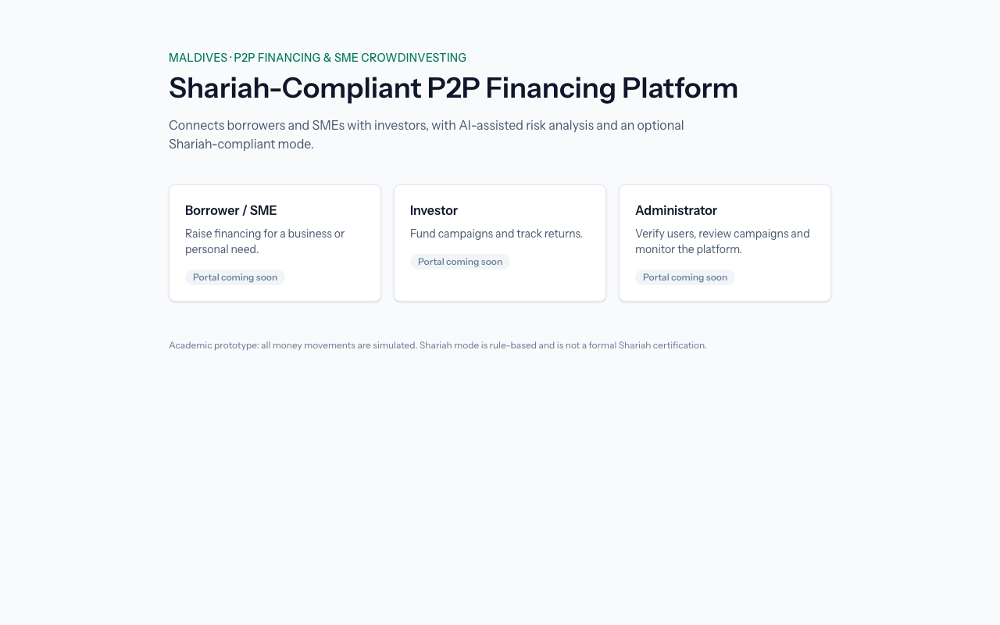

# PB-02 Scaffold Laravel + React + Tailwind on MySQL 8

Sprint 1 · chore · 3 points · traces to IR 2.4.1, 2.4.4 · GitHub issue #2

## What was built

The web application skeleton in `web/`:

- **Laravel 13** (PHP 8.5 locally, 8.3+ required) as the server-side framework.
- **Inertia.js 3** connecting Laravel to **React 19**: controllers return React pages instead
  of Blade views, so there is no separate API or frontend app.
- **Tailwind CSS 4** through its Vite plugin, built by **Vite 8**.
- **MySQL 8.4** (Homebrew, native) with a development database `shariah_p2p` and a separate
  test database `shariah_p2p_testing`, both accessed by a dedicated `shariah_p2p` user rather
  than `root`.
- A placeholder landing page (`/`) showing the three platform roles, with the
  academic-prototype and Shariah disclaimer text.
- Eight feature tests that prove the page renders through Inertia and that the app is really
  talking to MySQL 8.



## Key files

| File | Role |
|---|---|
| `web/routes/web.php` | Maps `GET /` to `WelcomeController` |
| `web/app/Http/Controllers/WelcomeController.php` | Returns `Inertia::render('Welcome', ['roles' => …])` |
| `web/app/Http/Middleware/HandleInertiaRequests.php` | Inertia middleware: root view, asset versioning, shared props |
| `web/bootstrap/app.php` | Registers the Inertia middleware on the `web` group |
| `web/resources/views/app.blade.php` | The one HTML shell; `@vite` loads assets, `@inertia` outputs the mount point and page data |
| `web/resources/js/app.jsx` | Starts Inertia and resolves page names to `resources/js/pages/*.jsx` |
| `web/resources/js/pages/Welcome.jsx` | The placeholder React page, styled with Tailwind classes |
| `web/vite.config.js` | Vite with the Laravel, React and Tailwind plugins |
| `web/phpunit.xml` | Points tests at the `shariah_p2p_testing` MySQL database |
| `web/tests/Feature/WelcomePageTest.php` | Page, component and props tests |
| `web/tests/Feature/DatabaseConnectionTest.php` | MySQL 8 connection and migration tests |

## Design decisions and alternatives

Recorded in `docs/decisions.md` (27 Oct 2026 rows).

1. **Inertia.js instead of a separate React SPA + JSON API.** A SPA would need Sanctum token or
   cookie auth, CORS, a CSRF-cookie handshake, duplicate routing (Laravel and React Router) and
   two test suites. Inertia keeps Laravel's session auth, CSRF protection, routing and
   validation, and lets PHPUnit assert which React page and data each role receives. The cost
   is no public API, which no requirement needs.
2. **No starter kit.** Laravel's React starter kit ships authentication, which would pre-empt
   PB-06 to PB-08. Inertia was added by hand (about five small files) so every line can be
   explained.
3. **MySQL natively instead of XAMPP.** XAMPP now bundles MariaDB, not MySQL 8.
   `DatabaseConnectionTest` fails on MariaDB or SQLite, so the stack choice is enforced, not
   just documented.
4. **Tests on MySQL, not SQLite.** Later wallet and pledge features rely on MySQL row locks and
   strict foreign keys, which SQLite does not enforce the same way.

## Sample code

How a Laravel route becomes a React page. The controller decides which page to show and what
data it gets:

```php
// web/app/Http/Controllers/WelcomeController.php
public function __invoke(): Response
{
    return Inertia::render('Welcome', [
        'roles' => [
            ['name' => 'Borrower / SME', 'description' => 'Raise financing for a business or personal need.'],
            // …
        ],
    ]);
}
```

On the browser side, Inertia looks the page name up in `resources/js/pages/` and passes the
data in as React props:

```jsx
// web/resources/js/app.jsx
createInertiaApp({
    resolve: (name) => {
        const pages = import.meta.glob('./pages/**/*.jsx', { eager: true });
        return pages[`./pages/${name}.jsx`];
    },
    setup({ el, App, props }) {
        createRoot(el).render(<App {...props} />);
    },
});
```

```jsx
// web/resources/js/pages/Welcome.jsx
export default function Welcome({ roles }) {
    // …
    {roles.map((role) => (
        <div key={role.name} className="rounded-lg border bg-white p-5 shadow-sm">
            <h2 className="font-semibold">{role.name}</h2>
        </div>
    ))}
}
```

## Unit test table

Run with `cd web && php artisan test` against MySQL 8.4.13 on 27 Oct 2026: 8 passed,
29 assertions.

| TC No | Input | Expected output | Actual output | Result |
|---|---|---|---|---|
| TC-02-01 | `GET /` | HTTP 200 | HTTP 200 | Pass |
| TC-02-02 | `GET /` | Inertia response for component `Welcome`; `resources/js/pages/Welcome.jsx` exists | Component `Welcome`, file found | Pass |
| TC-02-03 | `GET /` | Props contain `roles` with 3 items: Borrower / SME, Investor, Administrator (in order) | 3 roles in the expected order | Pass |
| TC-02-04 | `GET /does-not-exist` (invalid URL) | HTTP 404 | HTTP 404 | Pass |
| TC-02-05 | `POST /` (invalid method, empty body) | HTTP 405 Method Not Allowed | HTTP 405 | Pass |
| TC-02-06 | Default database connection | Driver name is `mysql` | `mysql` | Pass |
| TC-02-07 | `SELECT VERSION()` | Starts with `8.` and does not contain "MariaDB" | `8.4.13` | Pass |
| TC-02-08 | Run all migrations (`RefreshDatabase`) | `users` table exists | Table exists | Pass |
| TC-02-09 | TC-02-06/07 re-run with `DB_CONNECTION=sqlite` (negative check that the tests can fail) | Both tests fail | Both failed | Pass |
| TC-02-10 | `php artisan migrate:rollback` then `php artisan migrate` | All 3 default migrations roll back and re-run cleanly | Rolled back and re-ran | Pass |

TC-02-09 and TC-02-10 are manual checks, not part of the automated suite.
